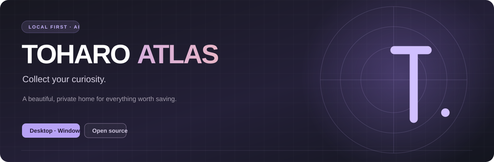
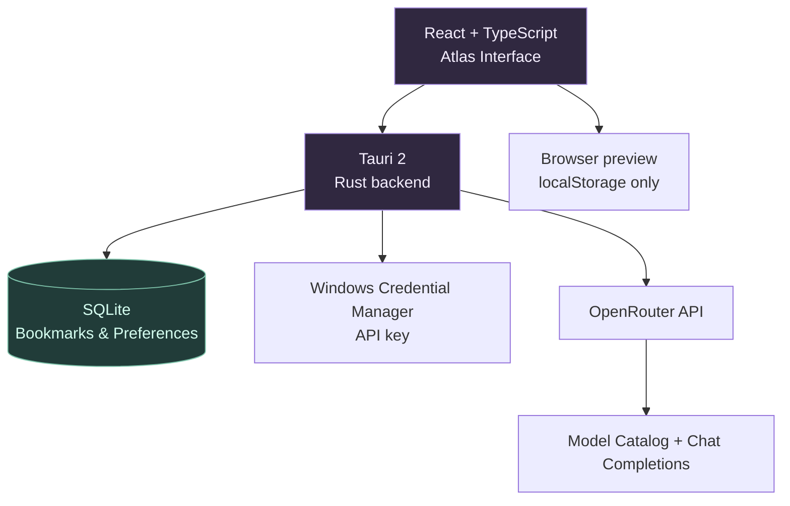

<div align="center">



<br/>

**Your scattered saves deserve a better home.**

Локальная AI-библиотека находок: собирай интересные ссылки, профили и идеи, находи связи и возвращайся к тому, что действительно важно.

[](https://github.com/conradipui-glitch/toharo_atlas/actions/workflows/ci.yml)


[**🚀 Скачать Windows-сборку**](https://github.com/conradipui-glitch/toharo_atlas/actions/workflows/ci.yml) · [**📋 План разработки**](#дорожная-карта) · [**🧩 Как устроено**](#архитектура)

</div>

---

## ✦ Что такое Atlas?

Instagram, YouTube, GitHub, полезные сайты — интересное разбросано повсюду. Мы ставим лайки, отправляем себе ссылки, создаём папки, а через месяц уже не помним, **зачем сохранили материал**.

**TOHARO Atlas превращает коллекцию ссылок в личную исследовательскую библиотеку.**

<table>
<tr><td width="33%" valign="top"><b>01 / СОБИРАЙ</b><br/><br/>Сохраняй ссылки на ролики, инструменты, авторов и статьи. Добавляй короткую заметку: «Зачем мне это?»</td><td width="33%" valign="top"><b>02 / ОРГАНИЗУЙ</b><br/><br/>Переключайся между коллекциями, авторами, ссылками и выжимками. Ищи сразу по всем материалам.</td><td width="34%" valign="top"><b>03 / ОСМЫСЛЯЙ</b><br/><br/>Подключи OpenRouter, выбери модель и получай краткие AI-описания и теги по доступным данным.</td></tr>
</table>

### ✨ Возможности версии 0.1

- **Visual Library:** спокойный тёмный интерфейс, акцент на карточках, собственная система оформления.
- **Collections & Creators:** тематические коллекции и объединение сохранённых материалов по автору.
- **Search:** поиск по заголовкам, URL, авторам, заметкам, тегам и выжимкам.
- **Model Manager:** живой каталог OpenRouter, фильтр бесплатных моделей, галочки «показывать», активная модель и ручной тест ответа.
- **AI Summaries:** анализ введённых названия, URL и заметки с генерацией тегов.
- **Your data, your device:** SQLite в Windows-приложении, экспорт и импорт JSON; ключ OpenRouter — в Windows Credential Manager.

> [!IMPORTANT]
> **Честная граница MVP:** приложение пока **не скачивает и не просматривает содержимое Reels**, не импортирует личные Instagram Collections и не читает переписки. AI Summary строится **только на предоставленных названии, URL и заметках**. Не выдаём анализ ссылки за анализ видео.

## 🖥️ Установка и запуск

### Готовый установщик Windows

Сборка приложения публикуется как артефакт успешного **Windows** job в [GitHub Actions](https://github.com/conradipui-glitch/toharo_atlas/actions/workflows/ci.yml). Открой успешный запуск → **Artifacts** → **toharo-atlas-windows-installer** → скачай архив и запусти NSIS-установщик.

> Ветка разработки: `feat/atlas-foundation`. Пока PR не слит, установщик находится в сборках этой ветки/PR, а не в Releases.

### Для разработки

Понадобятся **Node.js 20+**, **Rust (rustup)**, **Microsoft C++ Build Tools** и **WebView2** для Windows.

```powershell
git clone https://github.com/conradipui-glitch/toharo_atlas.git
cd toharo_atlas
git switch feat/atlas-foundation
npm install
npm run tauri dev
```

Веб-просмотр UI без нативных вызовов: `npm run dev`. Там вместо SQLite используется локальное хранилище браузера, а AI API не вызывается: **не вводи API-ключ в веб-просмотр**.

```powershell
npm run build   # TypeScript + Vite
npm test        # проверки архитектуры
npm run tauri build # NSIS installer
```

## 🧠 AI / Model Manager

Для начала достаточно ключа [OpenRouter](https://openrouter.ai/keys). Перейди в **Настройки → AI Model Manager**, сохрани ключ, нажми **«Обновить список»**, отфильтруй модели, отметь нужные галочками и выбери активную. **«Пинг выбранных» делает реальные запросы** и может расходовать квоту.

| Роль | Модель | Статус |
|:--|:--|:--|
| Текстовые выжимки и теги | `anthropic/claude-haiku-5.5` | API smoke-тест проходит |
| Быстрая классификация по категориям | `typesafe/jev-1.13` | **Кандидат на следующий этап** |
| Бесплатная decision-классификация | `inception/mercury-decide:free` (идентификатор проверить по live-каталогу) | **Кандидат на тесты** |

**Почему JEV отдельно?** Decision-модели принимают контекст и вопрос с вариантами ответа, возвращая типизированное решение и уверенность. Это **не** обычные chat-completions: для них нужен отдельный адаптер Decisions API. В версии 0.1 такой адаптер ещё не реализован. [Подробнее о Jev](https://openrouter.ai/blog/insights/what-is-jev/).

Ключ `OONR_API` допускается только в окружении CI/ручного smoke-теста и **никогда не включается в frontend или установщик**.

## 🧩 Архитектура



**Стек:** Tauri 2 · Rust · React 19 · TypeScript · Vite · SQLite · Lucide · OpenRouter. Никакого облачного сервера для личной библиотеки не требуется.

## 🗺️ Дорожная карта

| Этап | Ценность | Статус |
|:--|:--|:--|
| Foundation | Windows UI, локальная база, закладки, авторы, коллекции | ✅ Реализовано |
| AI Connections | OpenRouter, каталог, фильтры и тестирование моделей | ✅ Реализовано |
| Decision Router | Jev / Mercury Decide для экономной классификации | 🔜 Запланировано |
| Capture | Расширение браузера и удобное «Сохранить в Atlas» | 📌 В плане |
| Enrichment | Метаданные публикаций, первоисточники, безопасное извлечение | 📌 В плане |
| Knowledge | Семантический поиск, связи и исследование коллекций | 💭 Идея |

## 🔐 Приватность

**По умолчанию данные принадлежат тебе.** Записи хранятся локально. При вызове ИИ наружу передаются только данные выбранной находки, необходимые для анализа. Приложение не содержит телеметрии и не требует регистрации. Резервную копию можно выгрузить в JSON.

---

<div align="center">
<sub><b>TOHARO LAB</b> · Create, collect, connect.</sub><br/>
<sub>Made for curious minds — October 2026</sub>
</div>
